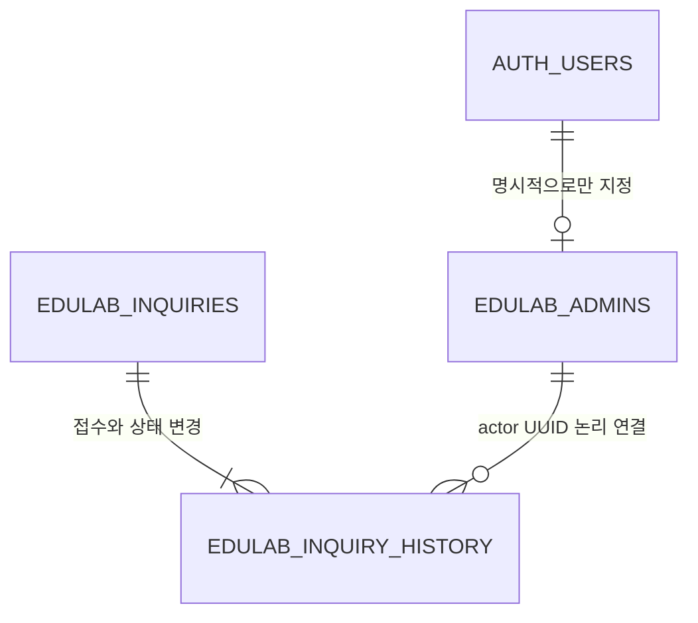

# 소스·DB 분석과 데이터 모델

## 1. 확인 범위

- 분석일: 2026-11-24, 대상 프로젝트 `ai-education-hub-dev`, Ref `uenvjqgylrevujdjpfed`.
- GitHub 원격에서 실제 브랜치 이름은 `codex/backend-phase1-supabase`이며 기준 커밋은 `0eeccd6`이다.
- 결과물은 그 커밋에서 분리한 `codex/edulab-shared-db-plan`에만 작성한다. 확인 시점 `main`은 `fc722e8`이며 변경하지 않는다.
- 프로젝트 조회, 테이블 목록·열·기본키·외래키 메타데이터, 마이그레이션 이력 조회 도구만 사용했다. SQL 실행 도구·마이그레이션 적용 도구를 호출하지 않았다. 실제 회원·문의·인증정보 행은 조회하지 않았다.
- 테이블 목록의 `rows` 값은 통계일 수 있어 실제 데이터 건수로 보고하지 않는다.

## 2. 분석 브랜치의 현재 구현

| 소스 | 구현·판단 |
|---|---|
| `supabase/migrations/20261122011730_phase1_inquiries.sql` | 별도 테스트 프로젝트용. 일반 이름의 테이블 4개, enum 4개, 범용 함수 2개, 확장 생성 포함. 공유 Production에 그대로 적용 금지 |
| `app/api/inquiries/route.ts` | 플래그·정책 확인, JSON 검증, 중복 방지와 서버 RPC 저장 경로 구현. 함수 이름 `create_inquiry`는 새 전용 이름으로 변경 필요 |
| `app/contact/contact-form.tsx` | `preventDefault()`와 입력 확인만 수행. 실제 API 전송·접수번호 표시·재시도 연계는 아직 없음 |
| `app/inquiries/request-guard.server.ts` | 인스턴스별 메모리 `Map`으로 10분 5회 제한. 서버리스 여러 인스턴스·재시작을 합친 제한이 아니어서 운영 보호로 부족 |
| `app/api/inquiries/route.ts` | 본문을 전부 읽은 후 바이트 제한 확인. 헤더 없이 큰 본문을 보낼 때 메모리 사용 제한이 늦음. 스트림 중단 방식 필요 |
| `app/lib/supabase/admin.ts` | 서버 비밀키로 `administrator_roles` 조회. 현주에듀랩 전용 권한 명부로 교체하고 사용자 JWT 기반 RLS를 함께 적용해야 함 |
| `app/admin/inquiries/page.tsx` | 서버 비밀키로 `inquiries` 목록 조회. 관리자 목록 조회는 사용자 JWT 클라이언트로 전환해 RLS를 실제 적용해야 함 |
| `app/api/admin/inquiries/[inquiryId]/route.ts` | 현재 원본은 Origin 없는 요청도 허용, `request.json()` 크기 상한 없음. 서버가 구한 actor를 넘기지만 새 RPC에서는 actor 입력 자체를 없애고 `auth.uid()`로 결정 |
| `app/inquiries/identifiers.server.ts` | 중복 키·개인정보가 포함된 본문의 일반 SHA-256 사용. 새 설계는 비밀키 HMAC과 용도별 구분자를 사용 |
| 상태 변경 SQL | 상태·revision 검사와 이벤트/감사 로그 동시 처리 취지는 유지. 중복 이력 저장은 한 테이블로 통합 |

`main`과 이 브랜치는 서로 갈라져 있다. 확인 시 main 쪽 8개, 분석 브랜치 쪽 1개 고유 커밋이 있었다. `main`의 회원·관리자 페이지와 이 브랜치의 `/admin`, `/admin/login`, `proxy.ts`가 다르므로 브랜치 전체를 그대로 병합하거나 운영에 배포하면 안 된다. 후속 구현은 최신 main을 기준으로 필요한 문의 기능만 통합 검토해야 한다.

## 3. 현재 DB 메타데이터

| 확인한 객체 | 확인한 구조 | 처리 원칙 |
|---|---|---|
| `public.member_profiles` | `user_id` PK, `auth.users.id` FK, 이름·이메일·선택 아이디/주소/전화·동의·상태·revision, RLS 활성 | 읽기 전용 보호 대상. 문의 관리자 판정에 사용하지 않음 |
| `public.member_administrators` | `user_id` PK/FK, `is_active`, `created_at`, RLS 활성 | 기존 역할을 복사·자동 승계하지 않음 |
| `public.member_account_audit_logs` | actor/target UUID, 변경 필드·이전/다음 상태·시각, RLS 활성 | 문의 이력과 혼합하지 않음 |
| `academy.courses` | UUID PK, slug, 제목·분류·공개 상태·목표 등, RLS 활성 | 조회·수정·마이그레이션 대상 아님 |
| `academy.course_weeks` | UUID PK, courses FK, 주차·제목, RLS 활성 | 변경 없음 |
| `academy.offerings` | UUID PK, courses FK, 일정·정원·공개 상태, RLS 활성 | 변경 없음 |
| `private_education.offering_admins` | `user_id` PK, RLS 활성 | 현주에듀랩 관리자와 무관 |
| `membership_private.administrator_invitations` | 비공개 초대 테이블 존재 | 변경·조회하지 않음 |
| `auth.users`, `auth.sessions` | 인증 객체 존재. sessions의 `id`, `user_id`, `not_after` 열을 메타데이터로 확인 | 신규 인증 계정 생성·기존 Auth 설정/트리거 변경 없음. 관리자 판정 함수는 필요한 상태만 읽음 |

### `published_courses` 확인 한계

테이블 목록 API에는 `published_courses`가 표시되지 않았다. **뷰·구체화 뷰일 수 있으므로 없다고 단정하지 않는다.** `public_course_catalog`, `public_offerings_catalog` 마이그레이션 이력은 확인했다. 이번에는 SQL 실행 금지 조건에 따라 뷰 정의·기존 GRANT·정책 전체·이벤트 트리거를 SQL로 추가 조회하지 않았다.

이 객체는 존재 여부와 무관하게 보호 대상으로 지정한다. 신규 문의 테이블은 `published_courses`나 `academy.courses`에 FK를 만들지 않는다. 향후 적용 전 별도 승인된 읽기 전용 카탈로그 조회로 실제 스키마·뷰 정의·권한·의존성을 확인해야 한다. 검토용 [preflight_readonly.sql](sql/preflight_readonly.sql)을 작성했지만 실행하지 않았다.

원격 마이그레이션에는 기존 교육 서비스 5개, 회원/관리자 3개, 기존 계정 등록 1개가 기록되어 있다. 분석 브랜치의 테스트 프로젝트용 `phase1_inquiries`는 해당 이력에 없었다. 이름 충돌 가능성을 확인 없이 `db push`로 해소하면 안 된다.

## 4. 테이블 필요성과 관계

- `edulab_admins`의 Auth FK는 기존 인증 신원을 참조할 뿐 기존 회원·관리자 테이블을 변경하지 않는다. Auth 계정이 삭제되면 이 전용 관리자 행만 연쇄 삭제된다. 문의 이력의 actor UUID는 남는다.
- 공개 문의는 비회원도 제출하므로 회원 테이블과 FK로 연결하지 않는다. 일반 회원의 본인 문의 조회도 이번 범위에 추가하지 않는다.
- 이력의 `actor_user_id`는 영구적인 당시 식별자다. Auth/관리자 행 삭제가 이력을 소거하거나 기존 Auth 계정 삭제를 막지 않도록 FK를 두지 않는다.
- 이력은 문의가 별도 승인된 보관기한 파기로 삭제될 때 함께 삭제되도록 새 테이블끼리만 `ON DELETE CASCADE`를 둔다. 이번 생성 SQL에는 DELETE나 파기 작업이 없다.

## 5. `public.edulab_inquiries` 컬럼

| 열 | 타입 | 필수·기본값·제약 | 생성 주체 |
|---|---|---|---|
| `id` | uuid | PK, 기본 `gen_random_uuid()` | DB |
| `inquiry_number` | text | UNIQUE, `EL-` + 혼동 문자 제외 12자리 | 서버 난수 생성 |
| `idempotency_key_hash` | text | UNIQUE, 소문자 hex 64자리 | 서버 HMAC, 원본 키 미저장 |
| `request_fingerprint` | text | hex 64자리 | 정규화한 제출 내용의 서버 HMAC |
| `program_slug` | text | 선택, 최대 80자 slug | 서버 허용 목록 검증 |
| `category` | text | 필수, safety/ai/lecture/collaboration | 서버·DB 검증 |
| `sender_name` | text | 필수, 공백 제외 1~80자 | 사용자 입력 후 서버 정리 |
| `sender_contact` | text | 필수, 7~50자 전화번호 형식 | 분석 브랜치와 맞춘 연락처 |
| `sender_email` | text | 선택, 최대 254자·기본 형식 검사 | 사용자 입력 후 서버 정리 |
| `message` | text | 필수, 공백 제외 1~2000자 | 사용자 입력 후 서버 검증 |
| `privacy_consent` | boolean | 필수 true, 기본값 없음 | 사용자의 실제 체크 확인 |
| `privacy_policy_version` | text | 필수 1~64자 | 승인된 서버 설정과 제출 버전 일치 확인 |
| `privacy_notice_hash` | text | 필수 hex 64자리 | 서버에 보관한 공개 동의 안내문 원문의 SHA-256 |
| `privacy_consented_at` | timestamptz | DB 접수 시각 | 클라이언트 시각 받지 않음 |
| `retention_days` | integer | 필수, 기술적 상한 1~3650일, 기본값 없음 | 확정된 서버 정책값 |
| `retention_due_at` | timestamptz | 필수, 생성 시각 이후 | DB에서 접수 시각 + 확정 일수 계산 |
| `status` | text | 기본 received, reviewing/answered 허용 | DB, 이후 전용 RPC |
| `revision` | integer | 기본 1, 양수 | DB, 상태 변경 시 +1 |
| `created_at` | timestamptz | DB 접수 시각 | DB |
| `updated_at` | timestamptz | DB 접수 시각, 이후 상태 변경 시각 | DB |

전화번호 필수·이메일 선택은 **현재 분석 브랜치와의 호환을 위한 제안**이다. 연락 방법을 이메일 중심으로 바꾸려면 사용자와 수집 목적을 확정한 뒤 폼·검증·DB 제약을 함께 바꾼다. 주소·비밀번호·신분증·생년·수강생 정보는 수집하지 않는다.

보관 일수의 기술적 상한은 적법한 보관 기간을 의미하지 않는다. 30일·90일 등 예시를 임의 운영값으로 적용하지 않는다. 수집 목적·항목·거부 시 영향·보유 기간·국외 처리 고지/동의 범위를 확정한 문구를 버전별 파일로 보관하고 그 해시를 기록한다. 별도 동의가 필요한 범위는 문구와 필드를 추가 검토한 뒤 승인받는다. 이 설계는 법률 적합성 확정 의견이 아니다.

## 6. 나머지 두 테이블과 인덱스

- `edulab_admins`: `auth_user_id uuid PK/FK`, `is_active boolean DEFAULT false`, `created_at timestamptz DEFAULT statement_timestamp()`, `revoked_at timestamptz NULL`. 초기 행·기본 관리자·이메일 자동 권한 부여 없음.
- `edulab_inquiry_history`: `id uuid PK`, `inquiry_id uuid FK`, `inquiry_revision integer`, `event_type`, `actor_type`, `actor_user_id uuid NULL`, `previous_status NULL`, `next_status`, `request_id uuid NULL`, `created_at timestamptz`.
- `(inquiry_id,inquiry_revision)` UNIQUE로 같은 revision 이력 중복 방지. 이 인덱스의 첫 열이 FK여서 동일 목적의 추가 인덱스는 만들지 않는다.
- 문의는 `(status,created_at DESC,id)`로 목록·상태 필터를 지원하고 `retention_due_at` 인덱스를 둔다. 전체 검색용 중복 인덱스·전문 검색·별도 접수번호 시퀀스는 만들지 않는다.
- 이력에는 이름·전화·이메일·본문·IP·관리자 자유 메모를 복제하지 않는다. 제출 이벤트와 상태 변경 이벤트를 모두 한 테이블에서 처리한다.

## 7. 생성 SQL 영향 범위

새 테이블 3개, 새 비공개 스키마 1개, 새 함수 4개(공개 2개·비공개 2개), 새 정책 3개, 새 테이블의 인덱스와 권한만 설계했다. 기존 테이블/뷰/함수/트리거/정책/기본 권한·확장·Auth 설정 변경은 없다. 기존 데이터 백필·관리자 승계·자동 작업도 없다.

생성 SQL의 UPDATE 문은 **새 상태 변경 함수 내부의 `edulab_inquiries` 단건 조건부 UPDATE** 한 곳뿐이다. 마이그레이션 적용 자체는 이 함수 본문을 실행하지 않는다. DROP·DELETE·TRUNCATE·WHERE 없는 UPDATE는 생성 SQL에 없다. 롤백의 DROP은 별도 파일에만 있으며 실행 기본값이 차단된다.

이름 충돌 시 `IF NOT EXISTS`나 `CREATE OR REPLACE`로 덮어쓰지 않고 전체 트랜잭션을 실패시킨다. FK 생성 등은 잠금을 유발할 수 있어 운영 무영향을 단정하지 않는다. 적용 승인 후 짧은 lock timeout과 트래픽이 적은 시간대에 한 파일씩 검증해야 한다.
