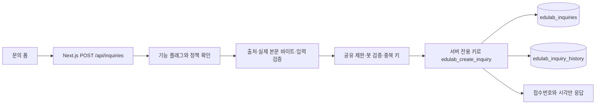

# 관리자 권한·RLS·서버 API 설계

## 1. 권한의 기준

현주에듀랩 문의 관리자는 `public.edulab_admins`에 **명시적으로 지정한 사용자만** 해당한다. 기존 `member_administrators`, `administrator_roles`, `private_education.offering_admins`, JWT의 사용자 메타데이터·이메일 주소 문자열은 권한의 근거로 사용하지 않는다.

관리자 요청은 서버에서 `auth.getUser()`로 확인하고 사용자 JWT를 유지한 Supabase 클라이언트로 데이터를 읽는다. DB 함수 `edulab_private.edulab_is_admin()`은 다음을 모두 확인한다.

1. `auth.uid()`가 존재한다.
2. 그 UUID의 `edulab_admins` 행이 활성 상태이고 회수 시각이 없다.
3. 실제 `auth.users` 행이 이메일 인증 완료·비익명·이용 정지 아님 상태다.
4. JWT의 서명된 `session_id`와 연결된 실제 `auth.sessions` 행이 남아 있고 `not_after`가 만료되지 않았다.

관리자 역할은 현재 DB 행에서 확인하므로 JWT에 예전 관리자 플래그가 남아 있어도 권한 회수를 우회하지 못한다. 세션 삭제·정지·권한 회수는 다음 요청에서 다시 검사한다. 이미 진행 중인 요청까지 소급 취소한다고 보장하지 않는다. 공유 프로젝트의 JWT 만료·SMTP·다른 서비스 Auth 설정은 변경하지 않는다.

## 2. 접근 행렬

| 호출자 | 문의 SELECT | 문의 INSERT | 상태 UPDATE | 전용 관리자 명부 | 이력 |
|---|---|---|---|---|---|
| 비로그인 `anon` | 차단 | 차단 | 차단 | 차단 | 차단 |
| 일반 로그인 회원 | RLS 결과 없음 | 차단 | 차단 | 자신의 지정 행만 조회, 대개 없음 | RLS 결과 없음 |
| 다른 홈페이지 관리자, edulab 지정 없음 | 일반 회원과 동일 | 차단 | 차단 | 자기 행 외 접근 없음 | 결과 없음 |
| 활성·인증·유효 세션의 edulab 관리자 | 허용 | 직접 쓰기 차단 | 전용 RPC만 허용 | 자기 행 조회만, 지정·승격 불가 | 조회만 허용 |
| 회수·정지·미인증·세션 만료 edulab 사용자 | 결과 없음 | 차단 | RPC 거절 | 자기 행 조회만 | 결과 없음 |
| 공개 접수용 서버 `service_role` | 중복 재요청 판정에 필요한 권한 보유 | 전용 접수 RPC/서버 경로 | 직접 UPDATE·관리자 RPC 차단 | 권한 없음 | 접수 기록 INSERT만 |
| DB 소유자·프로젝트 관리자 | 운영 권한의 별도 신뢰 경계 | 운영 권한의 별도 신뢰 경계 | 운영 권한의 별도 신뢰 경계 | 직접 지정 가능 | 운영 권한의 별도 신뢰 경계 |

RLS만 추가하고 브라우저 INSERT를 허용하는 설계는 사용하지 않는다. grants와 RLS를 같은 트랜잭션에 설정한다. 클라이언트 권한은 SELECT만 주고, 쓰기 정책은 주지 않는다. 새 객체의 기본 서비스 권한도 명시적으로 회수한 뒤 필요한 것만 부여한다. 기존 객체의 GRANT나 전역 기본 권한은 변경하지 않는다.

적용 전 `edulab_private`가 Data API의 노출 스키마 목록에 포함되지 않는지 확인한다. 확인 없이 공유 프로젝트의 노출 스키마 설정을 수정하지 않는다.

### 공통 비밀키의 한계

`service_role`/Supabase secret key는 프로젝트 공통 권한이다. 다른 서비스가 같은 권한의 키를 보유하면 `edulab_` 접두사나 RLS만으로 그 서버의 문의 조회까지 막을 수 없다. 별도 환경변수 이름을 붙여도 키 권한 자체가 분리되지는 않는다.

이번 안은 다른 사이트의 **일반 Auth 관리자에게 자동 권한을 주지 않는 설계**다. 공통 비밀키 보유 서버·DB 소유자까지 격리해야 한다면 운영 연결 전에 별도 최소 권한 DB 접속 역할과 자격증명 방식으로 재설계해야 한다. 이를 완전한 서비스 간 격리로 표현하지 않는다.

## 3. 공개 문의 흐름

### 서버 API의 필수 순서

1. `EDULAB_INQUIRY_API_ENABLED=false`를 기본값으로 둔다. 확정 정책·서버 키·공유 남용 방지 설정이 없으면 `503`으로 닫는다. 현재 환경변수는 변경하지 않는다.
2. `application/json` 미디어 타입을 정확히 파싱한다. `application/json-invalid`를 허용하지 않는다. 허용한 정확한 Origin만 받고 관리자 쿠키 요청은 Origin 누락도 거절한다. CORS/Origin 검사는 인증이나 봇 차단의 대체 수단이 아니다.
3. Content-Length는 조기 거절 힌트로만 쓴다. 요청 스트림을 읽는 동안 누적 바이트 12,000을 초과하면 즉시 취소하고 `413`을 반환한다. `request.text()`로 무제한 전체 수신 후 검사하지 않는다. 타임아웃·동시 요청 제한도 둔다.
4. JSON 객체만 허용하고 알려진 필드만 파싱한다. 이름·연락처·선택 이메일·본문·유형·선택 프로그램·정확한 true 동의·최신 정책 버전을 검증한다. 파일 첨부·관리자 ID·상태·수신시각·보관기간 등 임의 필드는 받지 않는다. XSS 문자열은 텍스트로 렌더링하며 HTML로 실행하지 않는다.
5. 허니팟 + 플랫폼/공유 저장소 기반 제한을 적용한다. 초기 제안은 출처별 10분 5회 및 전체 처리량 제한이나 운영 데이터로 조정한다. 메모리 Map은 보조 장치로만 사용한다. 신뢰한 호스팅 프록시의 IP만 서버에서 얻고 원본 IP 대신 용도 분리 HMAC으로 제한 버킷을 만들며 짧은 TTL 후 버린다. IP만으로 사람을 확정하지 않는다.
6. 자동화 위험에 따라 서버가 검증하는 챌린지를 사용한다. 검증 실패·서비스 장애·공유 제한 저장소 장애는 안전하게 거절하며 DB 저장은 하지 않는다. 구체적인 플랫폼/봇 서비스 도입·비용·개인정보 처리 범위는 별도 승인 전까지 미정이고, 준비 전 공개 접수 활성화는 금지한다.
7. 브라우저가 만든 고엔트로피 UUID 중복 키를 헤더로 받는다. 같은 제출의 네트워크 재시도는 키를 유지하고, 내용 변경·새 제출은 새 키를 쓴다.
8. 서버에서 키의 HMAC과 정규화된 제출 내용의 HMAC을 계산한다. `idempotency:`·`fingerprint:`·`rate:`로 용도를 분리한다. 동의 안내문 해시는 공개 안내문 원문의 SHA-256이며 서버에서 정한다. 본문·연락처가 들어간 일반 해시를 공개 식별자로 사용하지 않는다.
9. 승인된 서버 정책 버전·안내문 해시·보관 일수와 난수 접수번호를 넣고 `edulab_create_inquiry`를 호출한다. 클라이언트가 보낸 시각·관리자·상태·보관 일수는 신뢰하지 않는다. DB가 접수·동의 시각과 보관 만료일을 정한다.
10. RPC가 문의와 최초 이력을 한 트랜잭션으로 저장한다. 같은 중복 키+같은 내용은 200 재응답, 같은 키+다른 내용은 409, 최초 저장은 201이다. 서로 다른 문의의 접수번호 충돌이나 일시적 직렬화 실패만 제한 횟수 내 재시도한다. 검증·권한 오류를 무조건 재시도하지 않는다.
11. 공개 응답에는 결과·접수번호·접수시각만 담고 이메일·전화·본문·다른 문의 정보를 반환하지 않는다. `Cache-Control: no-store`를 사용한다. 로그에는 요청 ID·결과 코드만 남기고 본문·인증 토큰·비밀키·동의 원문을 기록하지 않는다.

### 제안 환경변수: 파일 작성만, 실제 설정 변경 없음

| 변수 | 용도 |
|---|---|
| 기존 `NEXT_PUBLIC_SUPABASE_URL` | 반드시 기존 프로젝트 URL. 별도 프로젝트 생성 없음 |
| 기존 `NEXT_PUBLIC_SUPABASE_PUBLISHABLE_KEY` | 로그인/JWT 클라이언트용 공개 키 |
| `EDULAB_SUPABASE_SECRET_KEY` | 서버 접수 전용으로 사용하는 secret. 이름이 바뀌어도 프로젝트 공통 권한임에 유의 |
| `EDULAB_INQUIRY_API_ENABLED` | 기본 false |
| `EDULAB_INQUIRY_POLICY_VERSION` | 확정 안내문 버전 |
| `EDULAB_INQUIRY_NOTICE_HASH` | 확정 공개 안내문 해시 |
| `EDULAB_INQUIRY_RETENTION_DAYS` | 확정 보관 일수. 기본값 없음 |
| `EDULAB_INQUIRY_HMAC_KEY` | 충분한 난수의 별도 서버 비밀키, 최소 32바이트 제안 |
| 남용 방지 제공자 설정 | 구체 서비스 선택·승인 후 추가. 미설정 시 공개 접수 거절 |

Secret에는 `NEXT_PUBLIC_` 접두사를 쓰지 않는다. URL·키를 임의로 교체하면 같은 저장소의 기존 로그인도 영향을 받을 수 있어 기존 값과 범위를 먼저 확인한다. Supabase Auth의 Site URL·Redirect URL·SMTP·프로젝트 API 설정을 덮어쓰지 않는다.

## 4. 문의 관리자 흐름

1. 기존 Auth로 로그인한다. 코드에서 지정 이메일을 하드코딩하거나 `user_metadata.role`을 읽어 관리자 권한을 부여하지 않는다.
2. 페이지와 모든 API/Server Action에서 `getUser()`와 전용 역할을 확인한다. 레이아웃의 검사만 믿지 않는다.
3. 목록은 사용자 JWT 클라이언트로 `edulab_inquiries`를 조회한다. 민감 페이지·API는 동적 렌더링과 `private, no-store`, `noindex`, 제한된 페이지 크기를 사용한다.
4. 상태 변경은 사용자 JWT로 `edulab_change_inquiry_status(inquiry_id,expected_revision,next_status,request_id)`를 호출한다. `actor_user_id` 매개변수는 존재하지 않는다.
5. 비공개 함수가 현재 권한을 다시 확인하고 본 서비스의 관리자 행과 해당 문의만 잠근다. `received → reviewing → answered`만 허용하고 오래된 revision은 409로 매핑한다.
6. 단건 UPDATE와 이력 INSERT는 한 트랜잭션이다. 이력 실패 시 상태도 저장되지 않는다. 직접 UPDATE·이력 변조·권한 자가 부여는 금지한다.
7. 관리자 권한 회수는 본 서비스 명부만 비활성화한다. 다른 사이트의 관리자 지위·회원정보·계정 상태를 바꾸지 않는다.

## 5. 기존 코드의 후속 수정 목록: 이번에는 수정하지 않음

| 기존 | 후속 변경 |
|---|---|
| `administrator_roles` 조회 | `edulab_admins`와 현재 사용자 확인, 전용 권한으로 교체 |
| secret client의 문의 목록 조회 | 사용자 JWT 클라이언트 + `edulab_inquiries` RLS |
| `create_inquiry` RPC | payload 계약을 맞춘 `edulab_create_inquiry` |
| `change_inquiry_status` + actor 인자 | 사용자 JWT의 `edulab_change_inquiry_status`, actor 인자 삭제 |
| HJ 접수번호 | EL 접수번호와 파서·검증·안내 일치 |
| 메모리 제한만 사용 | 운영 공유 제한·서버 봇 검증·실제 스트림 상한 |
| 입력 확인만 하는 폼 | 동의·정책·봇 검증·중복 키·실제 POST·처리 중/성공/실패/재시도 표시 |
| 기존 `/admin` 라우트 전부 덮어쓰기 | main의 계정 관리·보호 구조를 보존하면서 문의 권한을 별도 검사 |

## 출처

- [Supabase RLS](https://supabase.com/docs/guides/database/postgres/row-level-security)
- [Supabase 키와 API 보안](https://supabase.com/docs/guides/api/securing-your-api)
- [Supabase 함수 보안](https://supabase.com/docs/guides/database/functions)
